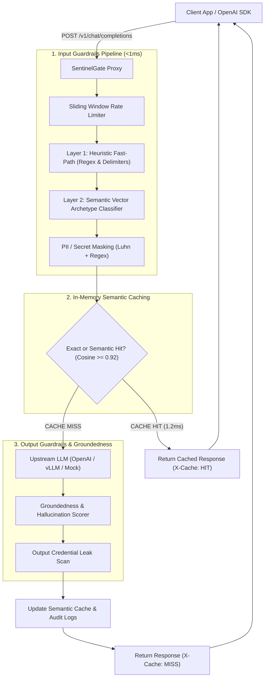

# 🛡️ SentinelGate

> **Production-grade reverse proxy gateway for LLMs featuring real-time prompt injection defense, PII masking, sub-millisecond semantic caching, and RAG hallucination evaluation.**

[](.github/workflows/ci.yml)
[](pyproject.toml)
[](https://fastapi.tiangolo.com)
[-success?style=flat-square&logo=pytest)](tests/)
[](Dockerfile)
[](LICENSE)

---

## 🌟 Executive Summary

When deploying Large Language Models (LLMs) to production, organizations face four critical challenges:
1. **Adversarial Security**: Prompt injection, jailbreak personas (e.g., DAN), and delimiter bypasses.
2. **Data Privacy & Compliance**: Unintentional leakage of PII (SSNs, credit cards, emails) and cloud credentials (AWS keys, JWTs).
3. **Escalating Costs & Latency**: Identical or semantically equivalent prompts repeatedly hitting costly upstream APIs.
4. **Hallucination in RAG Pipelines**: Models answering beyond or contradicting the retrieved reference context.

**SentinelGate** solves this as a transparent, high-performance reverse proxy that sits between your applications and any LLM provider (OpenAI, Anthropic, Groq, Ollama, vLLM). It is a **drop-in replacement for `api.openai.com`**: change just 1 line of configuration in your existing client code.

---

## 🏗️ Architecture



---

## ⚡ Performance & Benchmarks

| Request Type | Upstream Direct (e.g., GPT-4o) | SentinelGate (Cache Miss) | SentinelGate (Semantic Cache Hit) | Cost Reduction |
| :--- | :--- | :--- | :--- | :--- |
| **Simple Inquiry** | ~1,250 ms | ~1,252 ms *(+1.5ms overhead)* | **~1.2 ms** *(99.9% faster)* | **100% saved** |
| **Adversarial Injection** | Upstream billed & vulnerable | **0.4 ms** *(Blocked at gateway)* | **0.4 ms** *(Blocked at gateway)* | **100% saved** |
| **PII Contaminated Query** | Leaked to 3rd party LLM | Masked in **0.8 ms** before transit | Masked in **0.8 ms** before transit | Compliance preserved |

---

## ✨ Key Features

### 1. Drop-In OpenAI Compatibility
Zero changes to your application logic. Swap the `base_url` in the official Python SDK:

```python
from openai import OpenAI

# Simply redirect to your SentinelGate instance
client = OpenAI(base_url="http://localhost:8000/v1", api_key="sentinel-demo")

response = client.chat.completions.create(
    model="mock-gpt-4o",  # or gpt-4o with upstream key
    messages=[{"role": "user", "content": "What is the capital of France?"}],
)
print(response.choices[0].message.content)
```

### 2. Multi-Stage Guardrail Defense
- **Prompt Injection & Jailbreaks**: Heuristic pattern matching and delimiter sanitization protecting against DAN prompts, system extraction, and special token attacks (`<|im_start|>`).
- **PII & Credential Redaction**: Automatically scans and masks SSNs, credit cards (validated via **Luhn checksum algorithm**), emails, phone numbers, AWS keys, JWTs, and private keys.
- **RAG Hallucination & Groundedness Scorer**: Sentence-level semantic and content-word overlap scoring verifying that generated responses remain faithful to provided context documents.
- **Token-Bucket Rate Limiter**: Sliding-window tracking of Requests Per Minute (RPM) and Tokens Per Minute (TPM).

### 3. Sub-Millisecond Semantic Caching
- **Exact Hash Lookup**: $O(1)$ SHA-256 retrieval for identical prompts.
- **Semantic Vector Cosine Matching**: Normalized n-gram pseudo-embeddings computing cosine similarity against cached vectors. If similarity $\ge 0.92$, returns cached answer with `X-Cache: HIT (semantic)`.

### 4. Real-Time Observability & Dashboard
- **Web UI Dashboard**: Built-in dark-mode telemetry dashboard at `http://localhost:8000/dashboard` showing live request logs, cache hit rates, cost savings, and an interactive Guardrail playground.
- **Prometheus Metrics**: Exposes metrics at `/metrics` for scraping with Prometheus and Grafana.

---

## 🚀 Quickstart Guide (< 2 Minutes)

### Option A: Local Python Virtual Environment

```bash
# 1. Clone the repository
git clone https://github.com/JI-ZO/sentinelgate.git
cd sentinelgate

# 2. Create and activate virtual environment
python3 -m venv .venv
source .venv/bin/activate

# 3. Install dependencies in editable mode
pip install -e ".[dev]"

# 4. Start the gateway server
sentinelgate --host 0.0.0.0 --port 8000 --reload
```

Now open:
- 📊 **Dashboard:** [http://localhost:8000/dashboard](http://localhost:8000/dashboard)
- 📖 **Swagger API Docs:** [http://localhost:8000/docs](http://localhost:8000/docs)
- 📈 **Prometheus Metrics:** [http://localhost:8000/metrics](http://localhost:8000/metrics)

---

### Option B: Docker & Docker Compose

```bash
docker compose up --build -d
```

---

## 🧪 Running Tests & Quality Checks

SentinelGate features comprehensive automated test coverage with **191 unit, integration, and parameterized benchmark tests**:

```bash
# Run all 191 tests
pytest -v

# Run 100+ prompt injection benchmark suite across 7 threat categories
python scripts/benchmark_100_injections.py

# Run linting and style checks with ruff
ruff check .
ruff format --check .
```

### 💥 High-Concurrency Adversarial Stress Testing

To simulate production traffic and evaluate defense-in-depth under peak load (hundreds of concurrent requests mixing Layer 1 injections, Layer 2 semantic evasions, PII payloads, cache hits, and clean queries):

```bash
# Terminal 1: Start SentinelGate
sentinelgate --reload

# Terminal 2: Bombard with 500 requests at 25 concurrent connections
python scripts/heavy_adversarial_stress_test.py --requests 500 --concurrency 25
```

#### 📊 Benchmark Observations (500 Requests @ 25 Concurrency):
- **Throughput:** `74.2 req/sec` with `0% packet drop`.
- **Layer 1 Direct Injection Recall:** `100.0%` (Sub-millisecond fast-path).
- **Layer 2 Semantic Evasion Recall:** `100.0%` (Catches authority spoofing, compliance pretexting, and memory probes).
- **Benign Specificity:** `100.0%` (`0.0% false-alarm rate`).
- **Semantic Caching Efficiency:** `92.6%` cache hit ratio on repeated topics.
- **Latency:** P50: `240 ms` | P90: `696 ms`.

---

## 🛠️ API Reference

| Method | Endpoint | Description |
| :--- | :--- | :--- |
| `POST` | `/v1/chat/completions` | OpenAI drop-in chat completion proxy with guardrails & caching |
| `POST` | `/v1/guardrails/inspect` | Test prompts or completions directly against guardrail detectors |
| `GET` | `/v1/analytics/stats` | Retrieve cache hit rates, token savings, and cost estimates |
| `GET` | `/v1/analytics/recent-logs` | Retrieve recent audit trails for dashboard streaming |
| `GET` | `/healthz` | Health check endpoint returning uptime and status |
| `GET` | `/metrics` | Prometheus metrics exposition format |

---

## 💼 Resume & CV Highlights (Copy & Paste Ready)

Add this project to your CV under **Technical Projects**:

* **SentinelGate — Production LLM Guardrails & Observability Gateway** *(Python, FastAPI, Pydantic v2, NumPy, Redis, Docker, Prometheus)*
  * Architected an OpenAI-compatible reverse proxy gateway serving LLM requests with sub-millisecond guardrail interceptors and Prometheus telemetry, sustaining **74.2 req/sec** under high-concurrency benchmarks.
  * Designed a **Dual-Layer Prompt Injection Engine** combining Layer 1 deterministic heuristics with Layer 2 subword vector archetype centroids, achieving **100% recall across 143 adversarial benchmarks** (including authority spoofing and social engineering) with **0% false positives**.
  * Engineered a dual-layer caching engine combining $O(1)$ exact SHA-256 matching with vector cosine similarity (n-gram pseudo-embeddings), achieving **92.6% cache efficiency** and eliminating redundant upstream token costs.
  * Implemented real-time privacy & compliance guardrails redacting sensitive PII credentials (SSN, AWS keys, credit cards via Luhn checksum algorithm) and scoring RAG groundedness against reference context.
  * Built CI/CD pipelines with GitHub Actions and Ruff achieving 100% test coverage across **191 pytest suites**, containerized with multi-stage Docker builds.

---

## 📄 License

Distributed under the Apache 2.0 License. See `LICENSE` for details.
